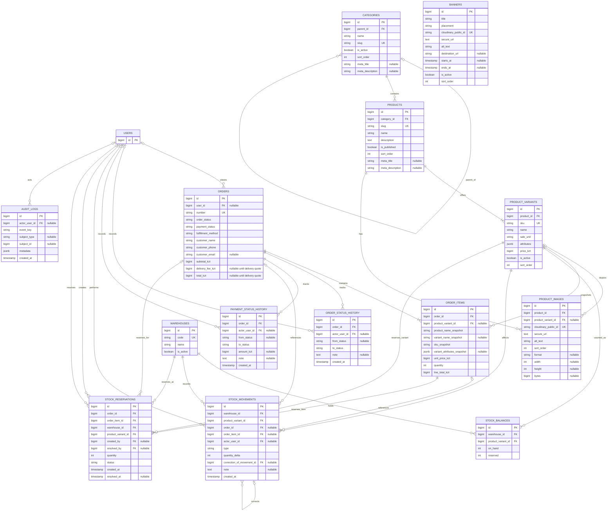

# Database — PostgreSQL

PostgreSQL is the system of record. This domain ERD is based on owner-approved decisions in [DECISIONS.md](DECISIONS.md), including product variants/SKUs and whole-unit quantities. Reversible Laravel migrations, Eloquent models, factories, the initial warehouse seeder and focused SQLite/PostgreSQL tests are implemented.

## Implemented domain ERD

### Relationship and lifecycle ownership

- Laravel's existing `users` table remains the identity source; order ownership is optional so guest checkout is supported. Order contact and delivery fields are snapshots, not references to an editable customer profile.
- Categories form an optional-parent tree. Products belong to one category in v1 and have a unique slug. Each product offers one or more variants; each purchasable variant has its own unique SKU, KZT price, sale-unit label and flexible JSONB attribute map (for example, size or color). Exact variant dimensions remain catalog data rather than schema-level columns. Quantities are integers; fractional cuts/weights are outside v1.
- Product images store Cloudinary references only; images can be product-wide or variant-specific. Credentials remain server-side.
- An order has one or more immutable item snapshots, including product name, variant name/attributes, SKU, price, quantity and line total. Deleting a catalog variant must not delete an order item; retain its variant reference as nullable with `ON DELETE SET NULL`.
- Order and payment lifecycles are separate. The normal order path is `new → confirmed → preparing → ready_for_pickup → completed` or `preparing → shipped → completed`; cancellation is allowed before completion. Payment transitions are `unpaid → paid → partially_refunded → refunded`, with direct `paid → refunded` also allowed. Store history as append-only rows with actor and timestamp; dispatch consumes stock, so a later cancellation must not release it again.
- `audit_logs` records privileged actions with an actor, stable event key and optional subject. Metadata must be allowlisted and must never include secrets, credentials or unnecessary customer data. Retention and access policy must be resolved before production (D-11).
- Fulfilment is `delivery` or `pickup`. Delivery address snapshots contain city, street and building; apartment and instructions are optional. A delivery fee and total may remain null until a manager confirms the coverage and charge; pickup orders have a zero fee and a total equal to their subtotal. Do not seed a pickup address or delivery-zone policy until D-06 is completed.
- One active warehouse is seeded for v1. `stock_balances` is the lockable current projection; `stock_movements` is the append-only ledger. `stock_reservations` records order-linked reserved quantities and release state.
- On manager confirmation, lock the affected balance rows and create reservations per order item atomically. There is no expiry. Cancellation releases an active reservation idempotently; dispatch consumes it. No return/refund tables are proposed until the legal review for D-07 is complete.

### Proposed database constraints and indexes

- Unique: category slug, product slug, variant SKU, Cloudinary public ID, order number, and `(warehouse_id, product_variant_id)` stock balance.
- Checks: KZT amounts are non-negative; order/reservation quantities are positive integers; stock movement deltas are non-zero integers; stock balance quantities are non-negative and `reserved <= on_hand`; line total equals unit price times quantity; when a delivery fee is known, `total_kzt = subtotal_kzt + delivery_fee_kzt`.
- Foreign keys use restrictive deletion for orders, history, stock movements, reservations and media. Optional identity/product references use `SET NULL` where preserving the business record is necessary. Categories with children/products cannot be deleted until dependencies are handled. Audit subjects are polymorphic by design; deleting an actor nulls the actor reference but never deletes the audit event.
- Index order lists by `(order_status, created_at)` and customer phone; history by `(order_id, created_at)`; stock ledger/reservations by `(warehouse_id, product_variant_id, created_at/status)`; catalog by publication/category/sort access patterns.
- Store timezone-aware timestamps in UTC and present them in the configured business timezone.

## Explicitly out of this initial schema

Do not add roles/permissions, customer profiles/addresses, carts, reviews, coupons, notifications/outbox, analytics, settings tables or return workflows until their implementation phase and applicable decisions are approved. Do not assume resolved delivery zones, pickup location, tax treatment, consent/retention rules or notification triggers. The open decisions are tracked in [DECISIONS.md](DECISIONS.md).

## Data integrity rules

- Use exact whole-KZT storage, never floating point. No tax line is included in v1 until the accounting/legal treatment is decided.
- Never trust client-supplied prices, totals, status transitions or stock quantities. Recalculate totals on the server.
- Keep order and payment status separate; record every transition append-only.
- Stock movement history is the audit source. Correct mistakes with compensating entries rather than rewriting the ledger.
- Make order submission and stock reservation/release transactional, idempotent and safe under concurrency with row locks or atomic updates.
- Do not cascade-delete business history. Review indexes and query plans against actual list/filter/report queries.
- Laravel's database queue is the default when asynchronous work is introduced; do not require Redis.

## Decisions that still constrain later features

The initial schema deliberately avoids features depending on open decisions. See [DECISIONS.md](DECISIONS.md) for delivery coverage/pickup configuration (D-06), legal/accounting review (D-07/D-08), reviews/loyalty/coupons (D-09), customer notifications (D-10), consent and retention (D-11), and expected volume/VPS sizing (D-13). D-16 is resolved for v1: only whole sale units.
